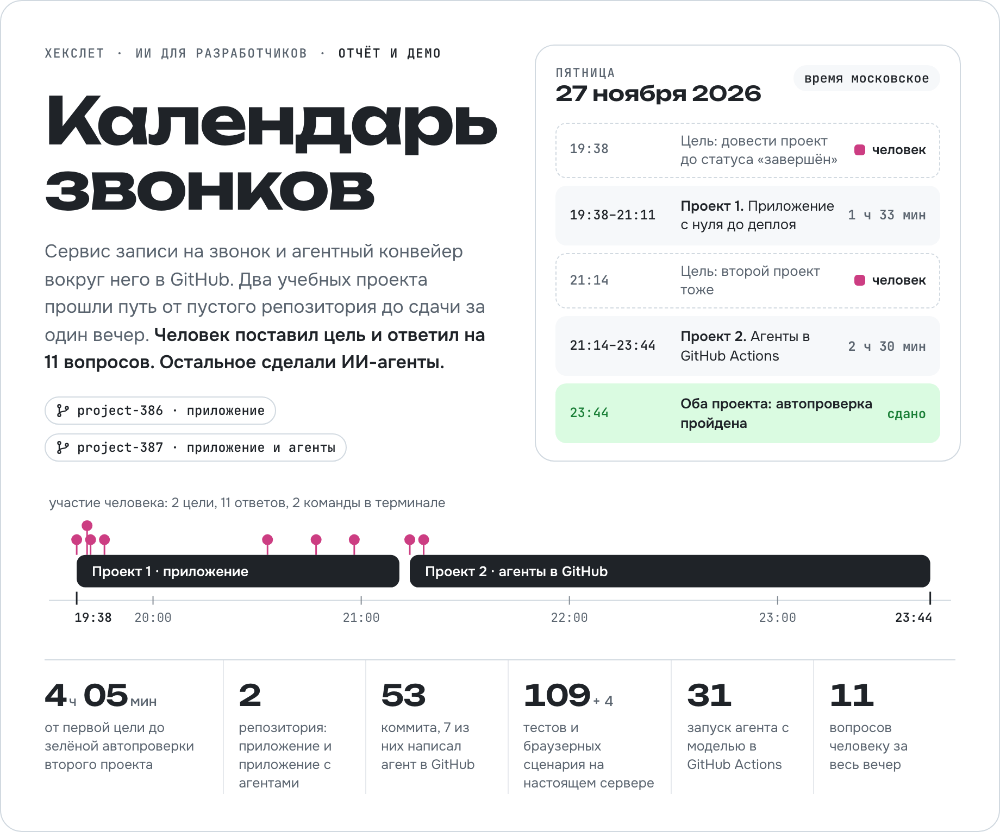
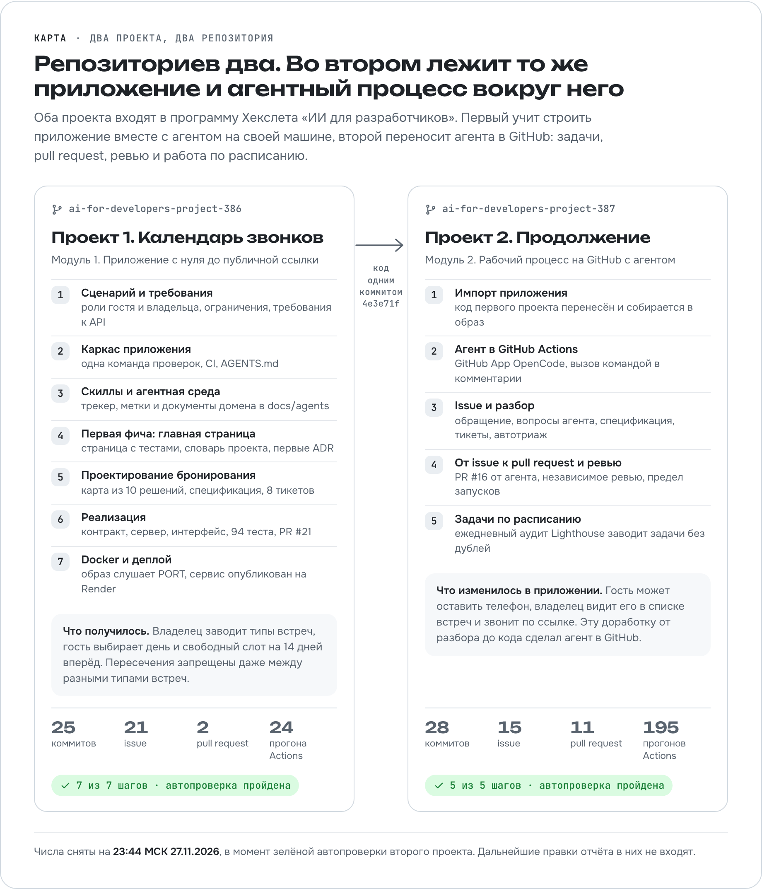
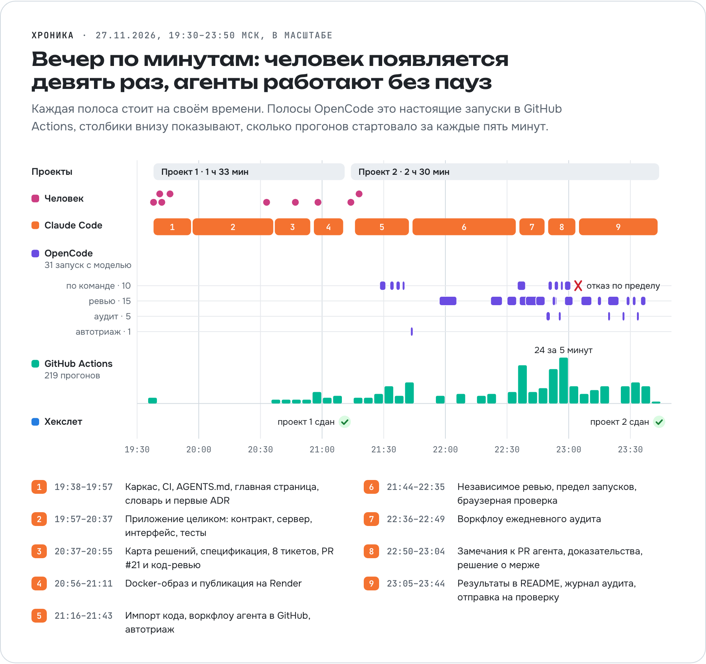
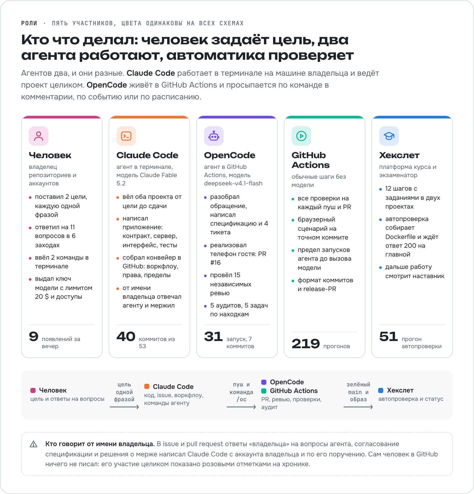
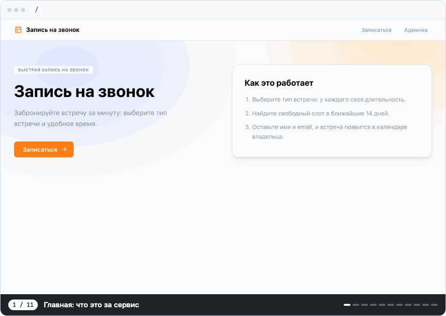
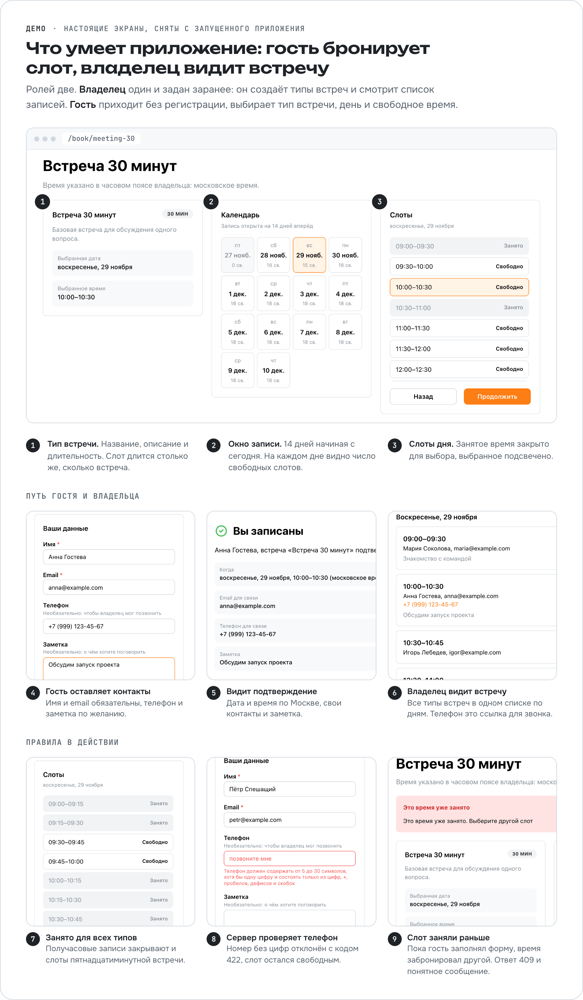
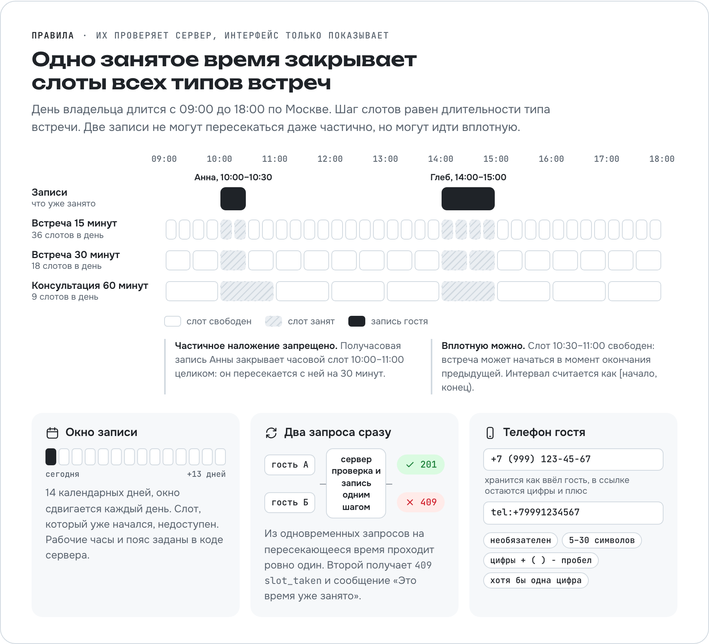
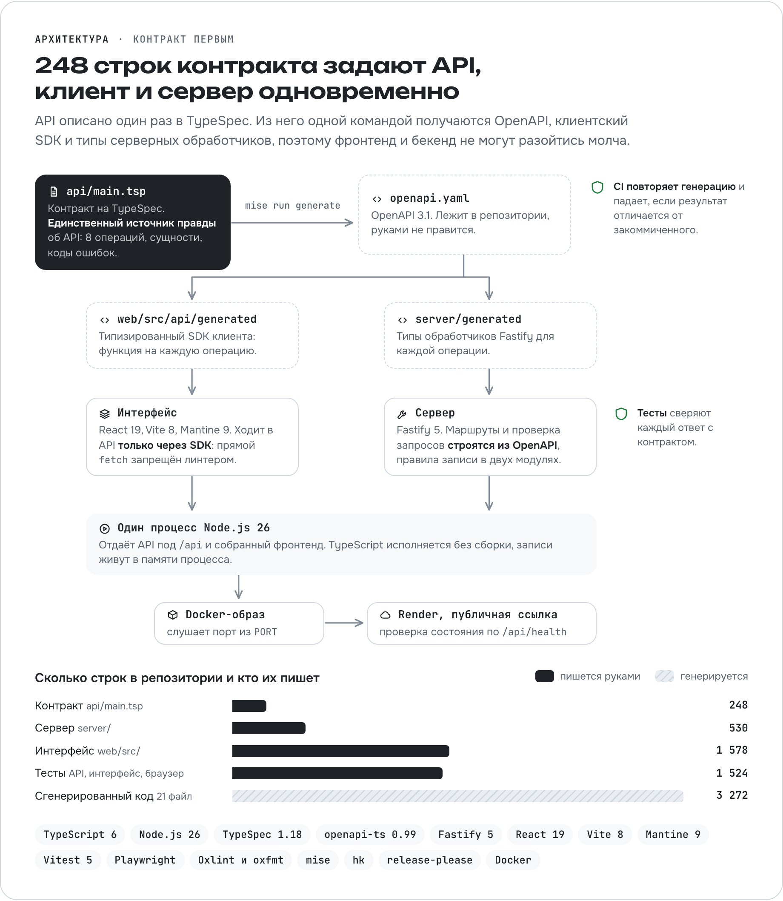
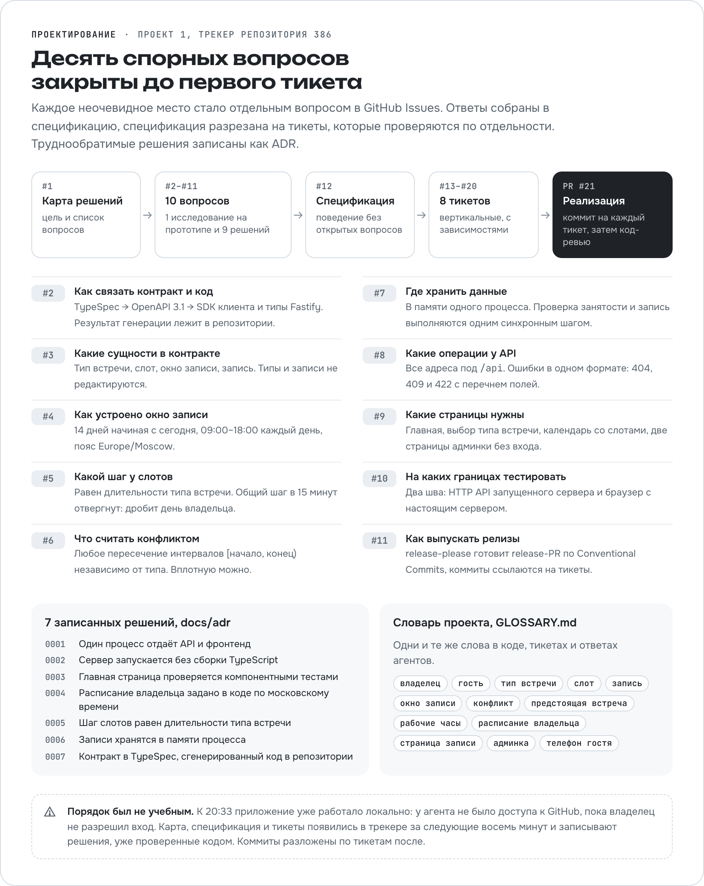
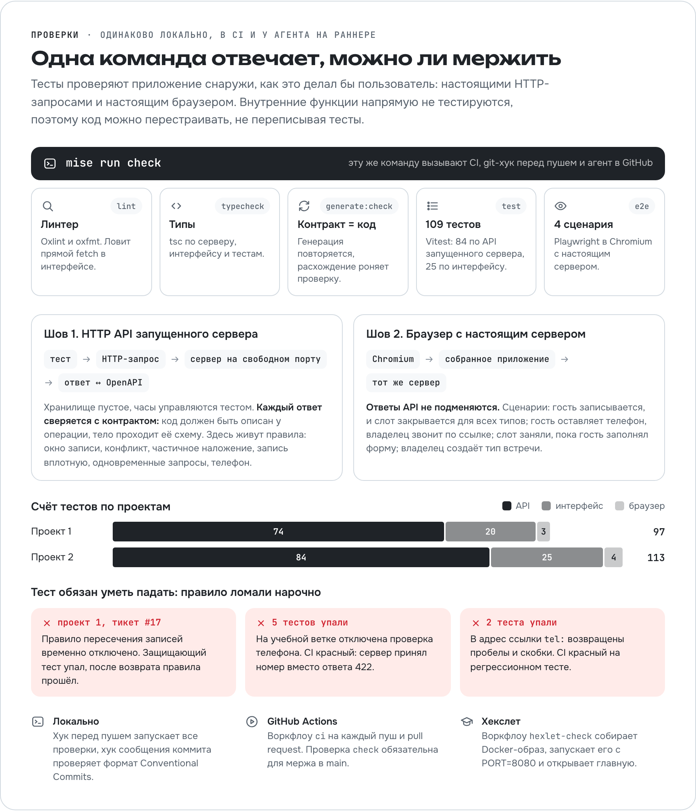

# Календарь звонков

[](https://github.com/andreykolomensky-prog/ai-for-developers-project-386/actions)
[](https://github.com/andreykolomensky-prog/ai-for-developers-project-386/actions/workflows/ci.yml)

<p align="center">
  <picture>
    <source media="(prefers-color-scheme: dark)" srcset="docs/story/01-hero.dark.png">
    
  </picture>
</p>

Разработайте совместно с ИИ сервис для бронирования календаря

Опубликованный сервис: https://ai-for-developers-project-386-piq5.onrender.com

Учебный проект Хекслета: https://ru.hexlet.io/programs/ai-for-developers
Как это должно работать: https://files.hexlet.app/a/2ipc5m

Это первый из двух проектов: здесь приложение «Запись на звонок» написано с нуля и опубликовано. Его целиком сделал ИИ-агент Claude Code на машине владельца за 1 час 33 минуты, человек поставил цель и ответил на вопросы об окружении и доступах. Ниже история этого проекта в картинках. Вторая часть, где агент переезжает в GitHub и сам дорабатывает приложение, лежит в [README второго репозитория](https://github.com/andreykolomensky-prog/ai-for-developers-project-387#readme).

> [!NOTE]
> Картинки общие для обоих репозиториев и сняты с итоговой версии второго проекта. В ней на одно поле больше: гость может оставить телефон. Поэтому на экранах есть поле «Телефон», а числа строк и тестов относятся к итоговой версии. В этом репозитории 94 теста и 3 браузерных сценария.

**Содержание:** [Карта: два проекта, два репозитория](#карта-два-проекта-два-репозитория) · [Хроника вечера](#хроника-вечера) · [Кто что делал](#кто-что-делал) · [Демо](#демо) · [Правила записи в картинке](#правила-записи-в-картинке) · [Архитектура](#архитектура) · [Проектирование](#проектирование) · [Проверки](#проверки) · [Что было дальше](#что-было-дальше) · [Справочник](#справочник)

## Карта: два проекта, два репозитория

<p align="center">
  <picture>
    <source media="(prefers-color-scheme: dark)" srcset="docs/story/02-map.dark.png">
    
  </picture>
</p>

Репозиториев два. Здесь лежит приложение. Во [втором](https://github.com/andreykolomensky-prog/ai-for-developers-project-387) лежит то же приложение и агентный процесс вокруг него: код перенесён одним коммитом с версии [`400138c`](https://github.com/andreykolomensky-prog/ai-for-developers-project-386/commit/400138c).

## Хроника вечера

<p align="center">
  <picture>
    <source media="(prefers-color-scheme: dark)" srcset="docs/story/03-timeline.dark.png">
    
  </picture>
</p>

Первые четыре фазы на полосе Claude Code это этот репозиторий: каркас и главная страница, приложение целиком, трекер и pull request, Docker и публикация.

## Кто что делал

<p align="center">
  <picture>
    <source media="(prefers-color-scheme: dark)" srcset="docs/story/04-roles.dark.png">
    
  </picture>
</p>

В этом репозитории работали трое: человек, Claude Code и автоматика GitHub Actions. Задачи в [трекере](https://github.com/andreykolomensky-prog/ai-for-developers-project-386/issues?q=is%3Aissue), решения и [pull request #21](https://github.com/andreykolomensky-prog/ai-for-developers-project-386/pull/21) оформил Claude Code с аккаунта владельца и по его поручению.

## Демо

<p align="center">
  
</p>

<p align="center">
  <picture>
    <source media="(prefers-color-scheme: dark)" srcset="docs/story/05-demo.dark.png">
    
  </picture>
</p>

Экраны сняты с версии второго проекта, отличие одно: поле «Телефон». Путь гостя и владельца проходит браузерный сценарий [e2e/booking.spec.ts](e2e/booking.spec.ts). Открыть сервис: https://ai-for-developers-project-386-piq5.onrender.com

## Правила записи в картинке

<p align="center">
  <picture>
    <source media="(prefers-color-scheme: dark)" srcset="docs/story/06-rules.dark.png">
    
  </picture>
</p>

Правила проверяет сервер: [server/schedule.ts](server/schedule.ts) и [server/booking.ts](server/booking.ts). Термины в [GLOSSARY.md](GLOSSARY.md), решения в ADR [0004](docs/adr/0004-owner-schedule-is-fixed-in-moscow-time.md), [0005](docs/adr/0005-slot-grid-step-equals-event-type-duration.md) и [0006](docs/adr/0006-bookings-live-in-process-memory.md). Карточка про телефон гостя относится ко второму проекту.

## Архитектура

<p align="center">
  <picture>
    <source media="(prefers-color-scheme: dark)" srcset="docs/story/07-architecture.dark.png">
    
  </picture>
</p>

Контракт: [api/main.tsp](api/main.tsp). Результат генерации: [api/generated/openapi.yaml](api/generated/openapi.yaml), `web/src/api/generated`, `server/generated`. Решения: ADR [0001](docs/adr/0001-one-process-serves-api-and-frontend.md), [0002](docs/adr/0002-server-runs-typescript-without-build.md), [0007](docs/adr/0007-contract-first-with-committed-generated-code.md).

## Проектирование

<p align="center">
  <picture>
    <source media="(prefers-color-scheme: dark)" srcset="docs/story/08-decisions.dark.png">
    
  </picture>
</p>

Всё в трекере этого репозитория: [карта решений #1](https://github.com/andreykolomensky-prog/ai-for-developers-project-386/issues/1), вопросы [#2](https://github.com/andreykolomensky-prog/ai-for-developers-project-386/issues/2)–[#11](https://github.com/andreykolomensky-prog/ai-for-developers-project-386/issues/11), [спецификация #12](https://github.com/andreykolomensky-prog/ai-for-developers-project-386/issues/12), тикеты [#13](https://github.com/andreykolomensky-prog/ai-for-developers-project-386/issues/13)–[#20](https://github.com/andreykolomensky-prog/ai-for-developers-project-386/issues/20), [pull request #21](https://github.com/andreykolomensky-prog/ai-for-developers-project-386/pull/21), [публикация #23](https://github.com/andreykolomensky-prog/ai-for-developers-project-386/issues/23). Решения: [docs/adr](docs/adr).

## Проверки

<p align="center">
  <picture>
    <source media="(prefers-color-scheme: dark)" srcset="docs/story/09-quality.dark.png">
    
  </picture>
</p>

Задачи проверок в [mise.toml](mise.toml), тесты в [test](test), [web/src](web/src) и [e2e](e2e), git-хуки в [hk.pkl](hk.pkl). Как проверяли, что тест умеет падать: [тикет #17](https://github.com/andreykolomensky-prog/ai-for-developers-project-386/issues/17).

## Что было дальше

Второй проект переносит работу в GitHub. Там агента зовут комментарием в issue, он сам разбирает обращение, пишет спецификацию и тикеты, открывает pull request и правит его по замечаниям, а раз в сутки ищет проблемы на опубликованной странице.

| Что посмотреть                        | Где                                                                                                                                                                                                                 |
| ------------------------------------- | ------------------------------------------------------------------------------------------------------------------------------------------------------------------------------------------------------------------- |
| Шесть воркфлоу вокруг агента          | [README второго репозитория, часть 2](https://github.com/andreykolomensky-prog/ai-for-developers-project-387#часть-2-агент-переезжает-в-github)                                                                     |
| Одна доработка от жалобы до мержа     | [цикл доработки](https://github.com/andreykolomensky-prog/ai-for-developers-project-387#один-цикл-доработки), [pull request агента](https://github.com/andreykolomensky-prog/ai-for-developers-project-387/pull/16) |
| Что защищает основную ветку от агента | [предохранители](https://github.com/andreykolomensky-prog/ai-for-developers-project-387#предохранители)                                                                                                             |
| Числа, грабли и дорожная карта        | [итоги](https://github.com/andreykolomensky-prog/ai-for-developers-project-387#часть-3-итоги)                                                                                                                       |

## Справочник

Подробности текстом: команды, адреса страниц, операции API и порядок публикации.

<details>
<summary>Сценарий: что требовал курс от приложения</summary>

«Запись на звонок» — упрощённый сервис бронирования времени по мотивам [Cal.com](https://cal.com).
В приложении две роли: владелец календаря (один, задан заранее) и гость (без регистрации).

### Владелец

1. Открывает раздел «Админка».
2. Создаёт тип встречи: название, описание и длительность в минутах (например, «Встреча 15 минут», 15 мин).
3. Видит созданный тип в списке типов встреч; при необходимости заводит ещё один с другой длительностью.
4. В списке «Предстоящие встречи» видит записи гостей по всем типам, отсортированные по времени начала.

### Гость

1. Открывает главную страницу и нажимает «Записаться».
2. На странице записи выбирает тип встречи — на карточке видны название, описание и длительность.
3. В календаре на ближайшие 14 дней выбирает день; справа отображаются слоты этого дня со статусом «Свободно» или «Занято».
4. Выбирает свободный слот, указывает имя, email и (по желанию) заметку, подтверждает запись.
5. Видит подтверждение. Выбранное время становится занятым для всех типов встреч.

### Сквозной сценарий

Владелец создаёт тип «Встреча 30 минут» → гость выбирает этот тип, день и слот 10:00–10:30, оставляет имя и email →
запись появляется в списке предстоящих встреч владельца, а интервал 10:00–10:30 больше нельзя занять
ни этим, ни другим типом встречи (в том числе частично: слот 10:15–10:30 типа «15 минут» тоже недоступен).

### Обязательные функции

- Типы встреч: название, описание, длительность. Создаёт владелец.
- Окно записи — 14 календарных дней, сдвигается с течением времени.
- Длительность слота равна длительности типа встречи.
- Пересечение записей запрещено, включая частичное наложение разных типов. Следующая встреча может начинаться в момент окончания предыдущей.
- Правило действует и для одновременных запросов: из двух конкурирующих бронирований успешным будет только одно.
- Список предстоящих встреч всех типов для владельца.

### Ограничения

- Нет авторизации, личных кабинетов, уведомлений и интеграций с внешними календарями.
- Владелец календаря один и задан заранее.

### Требования к API

- Контракт описывается в TypeSpec, из него генерируется OpenAPI-спецификация.
- Клиентский SDK для фронтенда генерируется из OpenAPI; вручную запросы к API не пишутся.
- Приложение собирается в Docker-образ и запускается в контейнере.

</details>

<details>
<summary>Стек</summary>

- TypeScript, Node.js 26
- Контракт: [TypeSpec](https://typespec.io/) → OpenAPI 3.1 → клиентский SDK и серверные типы через [openapi-ts](https://heyapi.dev/)
- Бекенд: [Fastify](https://fastify.dev/), маршруты и проверка запросов строятся из OpenAPI ([fastify-openapi-glue](https://github.com/seriousme/fastify-openapi-glue))
- Фронтенд: [React](https://react.dev/), [Vite](https://vite.dev/), [Mantine](https://mantine.dev/)
- Тесты: [Vitest](https://vitest.dev/) для API и компонентов, [Playwright](https://playwright.dev/) для браузерного сценария
- Линтер и форматирование: [Oxlint и oxfmt](https://oxc.rs/), проверка типов `tsc`
- Окружение и задачи: [mise](https://mise.jdx.dev/), git-хуки через [hk](https://hk.jdx.dev/)

</details>

<details>
<summary>Установка и использование</summary>

### Установка

Нужен только [mise](https://mise.jdx.dev/getting-started.html): версии Node.js и остальных инструментов записаны в `mise.toml`.

```bash
git clone https://github.com/andreykolomensky-prog/ai-for-developers-project-386.git
cd ai-for-developers-project-386
mise trust
mise install      # ставит инструменты и подключает git-хуки
mise run install  # ставит зависимости из package-lock.json
```

### Использование

```bash
mise run dev    # бекенд на http://localhost:3000, фронтенд на http://localhost:5173
mise run check  # все проверки; эту же команду запускает CI
mise run start  # сборка фронтенда и запуск как в продакшене на PORT (по умолчанию 3000)
```

Остальные задачи показывает `mise tasks`. Рабочие правила проекта для ИИ-агентов описаны в [AGENTS.md](AGENTS.md), словарь в [GLOSSARY.md](GLOSSARY.md), принятые решения в [docs/adr](docs/adr).

### Страницы

| Адрес                | Что на странице                                                         |
| -------------------- | ----------------------------------------------------------------------- |
| `/`                  | Главная страница: рассказ о сервисе и переход к записи                  |
| `/book`              | Страница записи: выбор типа встречи                                     |
| `/book/<id типа>`    | Календарь на 14 дней, слоты выбранного дня, форма гостя и подтверждение |
| `/admin`             | Админка владельца: предстоящие встречи всех типов                       |
| `/admin/event-types` | Админка владельца: типы встреч и форма создания                         |

### Правила записи

- Окно записи: 14 календарных дней, начиная с сегодняшнего дня по Москве.
- Рабочие часы владельца: 09:00–18:00 каждый день, часовой пояс `Europe/Moscow`. Интерфейс показывает московское время.
- Слот длится столько, сколько тип встречи. Слоты идут подряд от 09:00, шаг равен длительности типа.
- Две записи не могут пересекаться даже частично и даже для разных типов встреч. Встреча может начинаться в момент окончания предыдущей.
- Правила проверяет сервер: из одновременных запросов на пересекающееся время проходит один, остальные получают `409` и понятное сообщение.

</details>

<details>
<summary>Контракт API</summary>

Источник правды об API это [api/main.tsp](api/main.tsp). Одна команда пересобирает всю цепочку:

```bash
mise run generate
```

Она создаёт OpenAPI-спецификацию [api/generated/openapi.yaml](api/generated/openapi.yaml), клиентский SDK `web/src/api/generated` и типы обработчиков Fastify `server/generated`. Эти каталоги лежат в репозитории и руками не правятся: `mise run check` повторяет генерацию и падает, если результат отличается от закоммиченного.

| Метод и адрес                              | Назначение                                                   | Ответы                                                              |
| ------------------------------------------ | ------------------------------------------------------------ | ------------------------------------------------------------------- |
| `GET /api/event-types`                     | Список типов встреч                                          | `200`                                                               |
| `POST /api/event-types`                    | Владелец создаёт тип встречи                                 | `201`, `409` идентификатор занят, `422` ошибка данных               |
| `GET /api/event-types/{id}`                | Один тип встречи                                             | `200`, `404`                                                        |
| `GET /api/event-types/{id}/booking-window` | Окно записи: слоты на 14 дней с отметкой занятости           | `200`, `404`                                                        |
| `GET /api/bookings`                        | Предстоящие встречи всех типов                               | `200`                                                               |
| `POST /api/bookings`                       | Гость создаёт запись                                         | `201`, `404` тип не найден, `409` время занято, `422` ошибка данных |
| `GET /api/schedule`                        | Расписание владельца: часовой пояс, рабочие часы, длина окна | `200`                                                               |
| `GET /api/health`                          | Проверка запуска                                             | `200`                                                               |

</details>

<details>
<summary>Docker</summary>

```bash
docker build -t call-calendar .
docker run --rm -p 8080:8080 -e PORT=8080 call-calendar
```

Приложение стартует само, слушает порт из переменной окружения `PORT` и не требует внешних сервисов.

</details>

<details>
<summary>Хранение данных</summary>

Типы встреч и записи хранятся в памяти процесса. Перезапуск или новый деплой сбрасывает все записи и созданные владельцем типы встреч; при старте приложение заново создаёт два типа: «Встреча 15 минут» и «Встреча 30 минут». На бесплатном тарифе хостинга сервис засыпает после простоя, и данные при этом тоже сбрасываются.

</details>

<details>
<summary>Деплой</summary>

Сервис опубликован: **https://ai-for-developers-project-386-piq5.onrender.com**

Это веб-сервис [Render](https://render.com/) на бесплатном тарифе, собранный из `Dockerfile` в корне репозитория. Параметры сервиса описаны в [render.yaml](render.yaml): среда Docker, регион Frankfurt, проверка состояния по `/api/health`. Бесплатный сервис засыпает после 15 минут без запросов, поэтому первый запрос после паузы может отвечать до минуты.

Сервис подключён к публичному репозиторию без установки приложения Render в GitHub, поэтому новая версия выкатывается вручную: в дашборде Render кнопкой Manual Deploy → Deploy latest commit или через MCP-сервер.

### Подключение MCP-сервера Render

Агент может управлять деплоем через [MCP-сервер Render](https://render.com/docs/mcp-server): запускать выкат, читать логи и статус сервиса. Подключение без секретов в репозитории:

1. Создайте API-ключ в Render: Account Settings → API Keys.
2. Положите ключ в переменную окружения: `export RENDER_API_KEY=<ваш ключ>`. В Git ключ не добавляется.
3. Скопируйте шаблон проектной конфигурации: `cp .mcp.json.example .mcp.json`. Файл `.mcp.json` исключён из Git, заголовок авторизации берётся из `RENDER_API_KEY`.
4. Перезапустите агента и попросите его выбрать рабочее пространство Render, запустить выкат сервиса и проверить, что `GET /api/health` отвечает `200`.

</details>

---

<details>
<summary>Автоматические тесты Хекслета</summary>

Тесты запускаются на каждый коммит. За запуск отвечает файл `.github/workflows/hexlet-check.yml` — не удаляйте и не переименовывайте ни его, ни репозиторий.

</details>

## О Хекслете

[Хекслет](https://ru.hexlet.io/) — школа программирования: авторские программы обучения с практикой, поддержкой наставников и реальными проектами, которые остаются в резюме. Этот репозиторий — один из таких проектов.
